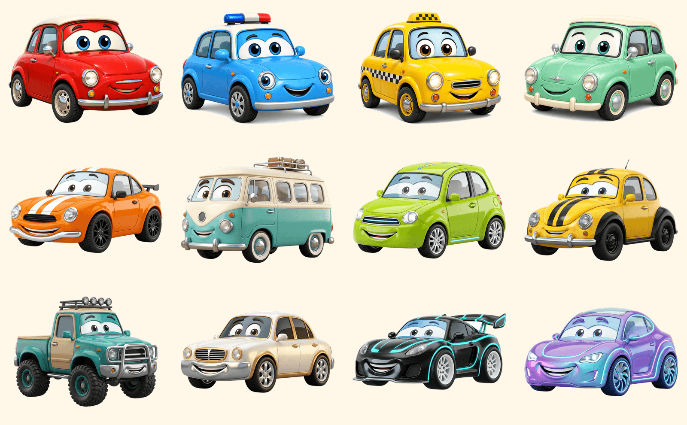
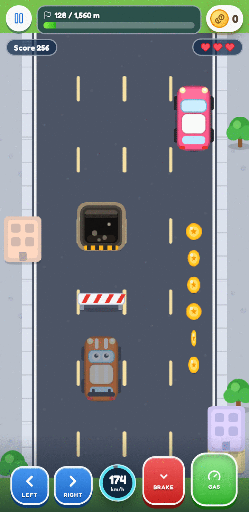
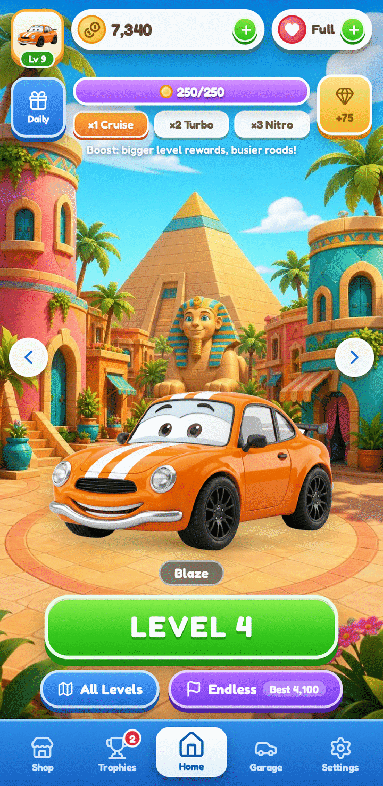
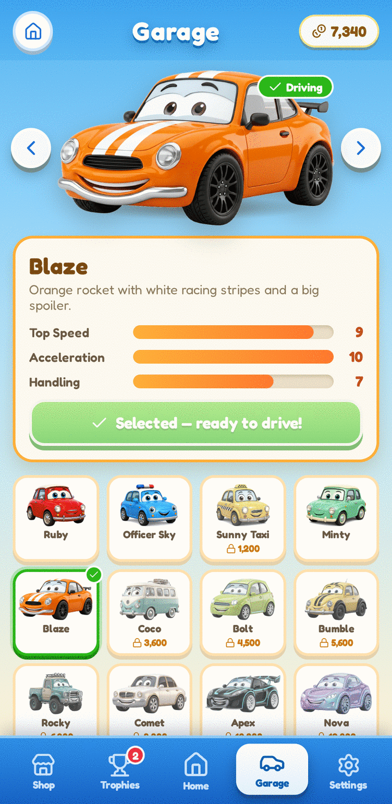
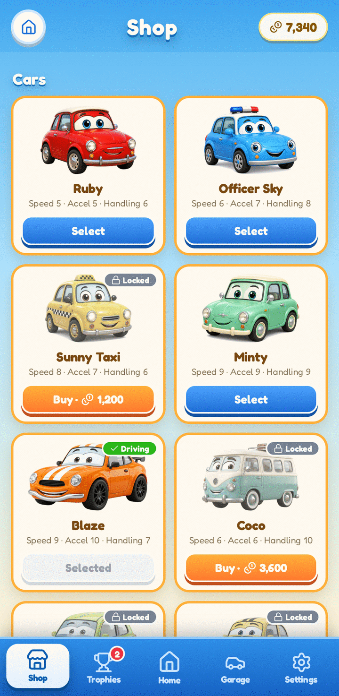

# 🚗 Cartoon Car Adventure

A colorful, family-friendly, mobile-first **cartoon driving game that runs entirely in the browser** — built with **React + TypeScript + Vite** for the menus/UI and **Phaser 3 (Arcade Physics)** for real gameplay. No backend, no installation, no real-money purchases.

**v1.1** · built by [Ausaf](https://ausafulislam.vercel.app) · see [CHANGELOG.md](CHANGELOG.md) for what changed


## Play it

| Action | Keyboard (desktop) | Touch (mobile) |
| --- | --- | --- |
| Steer left / right | `◀` `▶` or `A` / `D` | Hold the **LEFT** / **RIGHT** pads |
| Speed up | `▲` or `W` | Hold the green **GAS** pedal |
| Brake | `▼` or `S` | Hold the red **BRAKE** pedal |
| Pause | `P` / `Esc` | ⏸ button (top-left) |

The in-game control deck sits on a soft gradient that fades into the road: steering
pads on the left, pedals on the right and a **live speed dial** in the middle. Every
button is multi-touch aware (steer + accelerate at once), shows its pressed state and
releases itself automatically when the run pauses, the tab is hidden or you lift a
finger anywhere on screen.

**Goal:** drive the full distance to finish a level. Collect coins, dodge traffic
and the road works. Three crashes end the run — a **road blocker** costs a life,
driving into an open **construction pit** jolts the car and kills your clean run.
Earn up to **3 stars** per level: finish + coin goal + clean (crash-free) driving.
Near misses give bonus points!

## Features

- **Reference-style home screen** — original AI-generated tropical town + cute 3D-style hero car with idle animation, top HUD (profile / coins / hearts with a *real* regeneration timer), treasure-milestone progress bar, reward Boost selector, big green `LEVEL n` button and a 5-tab bottom navigation. Every button works.
- **Real gameplay (Phaser 3)** — scrolling themed roads, frame-rate independent steering/acceleration/braking, traffic cars & trucks that keep a gap, queue and overtake, construction road works (blockers + freshly dug pits), spinning coin chains, near-miss bonuses, crash invulnerability/blink, camera shake, particles, countdown, pause and auto-pause when the tab is hidden.
- **50 levels** — Sunny Streets all the way to Champion's Highway: every level has its own name, distance, coin goal, traffic density/speed and roadside theme (palms, cacti, city buildings…), ramping smoothly from 1,200 m to 7,080 m, plus an **Endless mode** with ramping difficulty and a saved best score. The level picker opens scrolled to your current level.
- **Progression & economy** — coins, hearts (start a run = 1 heart, finishing refunds it, +1 every 90 s, or buy for 50 coins), level unlocks & stars, Boost ×1/×2/×3 (bigger rewards, busier roads), 7-day daily rewards, a repeatable 250-coin treasure milestone.
- **Garage — 12 original cartoon cars** — Ruby, Officer Sky, Sunny Taxi, Minty, Blaze, Coco, Bolt, Bumble, Rocky, Comet, Apex and Nova. Each has its own hero artwork, top-down sprite styling (racing stripes, spoilers, roof racks, neon supercar glow…) and Speed/Acceleration/Handling stats that genuinely change handling & top speed, from the free starter to the 12,000-coin Nova.
- **Shop** — cars + 3 functional upgrades (Coin Magnet, Safety Shield, Turbo Tires) with confirmation dialogs, balance checks and owned/selected states. Earned currency only.
- **Trophies & daily missions** — **3 fresh daily missions pick themselves every day** (coins, level finishes, clean runs, distance, runs started, best score, Endless distance) with a visible countdown to the refresh; missions and their progress reset at local midnight exactly like the daily reward. Includes claimable coin rewards, a 150-star level overview and lifetime stats.
- **Settings** — music/SFX volume sliders (applied instantly), mute, vibration toggle, how-to-play, confirmed progress reset, the running version and a **Built by Ausaf** credit that links to [ausafulislam.vercel.app](https://ausafulislam.vercel.app).
- **Original synthesized audio** — cheerful music loop, engine hum that follows your speed, coin/crash/shield/win/lose/click sounds via Web Audio (no audio files, no licensing issues). Starts after the first user tap, per browser autoplay rules.
- **Persistent saves** — everything lives in `localStorage` with validation and safe fallbacks, so refreshes never lose progress.
- **Responsive layouts for every device** — 9:16-first mobile portrait (pixel-identical to the original design), compact heights on mobile landscape (All Levels + Endless as a balanced row), a compact left info rail on tablet portrait, and a three-column landscape layout on laptop/desktop/ultrawide where the game card expands with the window while UI elements stay proportionally sized — never a stretched canvas or an enlarged mobile interface.
- **Smart PWA install popup** — appears automatically ~10 seconds after load, only in browsers where installation is supported and the app isn't already installed; it never interrupts gameplay or another modal and won't reappear in the same session after dismissal. There is no permanent install button.

### The garage

Twelve cars, from the free starter **Ruby** to the 12,000-coin **Nova** — every one with its own art, stats and top-down sprite detailing:



## Screens

<p>
  
  
  
  
</p>


## Performance

The game is built to hold a steady frame rate on modest phones, and the work was
measured rather than guessed (headless Chrome with a throttled CPU and real touch
input, not just a fast desktop):

- **The DOM never animates per frame.** React only re-renders on real state changes
  (lives, shield, run state). Distance, coins, score, progress and the speed dial are
  written straight into the DOM at ~11 Hz, and the dial only re-paints its conic
  gradient in 2% steps. Pressing a pad toggles a class instead of setting React state,
  so a steering tap causes **zero** React renders.
- **Pressed buttons are compositor-only.** The pressed look animates `transform` and
  the opacity of two pseudo-element overlays — never `box-shadow` or `filter`, which
  force a repaint and a re-rasterise of the button over the live canvas (that alone
  was worth ~40% more frames while steering).
- **Phaser side:** one pooled particle emitter per tint and a single reused floating
  label instead of new objects per coin, WebGL MSAA off (every sprite is a
  pre-rasterised texture), and delta-time based steering so the car behaves the same
  at 30, 60 or 120 fps.
- **Traffic has real awareness** (car-following, lane changes) with a per-frame cost of
  a few dozen comparisons, not a physics overhaul.

## Run locally

Requirements: Node.js 18+ (developed on Node 20).

```bash
npm install --legacy-peer-deps   # --legacy-peer-deps avoids an npm 10 peer-resolution bug with the very latest Vite/React
npm run dev                      # http://localhost:5173
```

## Production build & deployment

```bash
npm run build      # type-checks (tsc) then builds to dist/
npm run preview    # serve the production build locally
```

Deployment is static — any static host works:

- **Vercel:** import the repo (a `vercel.json` is included) or run `npx vercel --prod`. Framework preset: *Vite*, output directory: `dist`.
- **Netlify / GitHub Pages / nginx / S3:** publish the `dist/` folder. The game uses no client-side routing, so no rewrite rules are required.

No environment variables, API keys or backend services are needed.

## Project structure

```
cartoon-car-adventure/
├── public/
│   ├── assets/
│   │   ├── cars/            # AI-generated hero car artwork (transparent PNGs)
│   │   └── environments/    # AI-generated home-screen town background
│   ├── icons/               # PWA icons (incl. maskable)
│   ├── screenshots/         # Install-prompt screenshots (referenced by the manifest)
│   ├── manifest.webmanifest
│   └── og-image.png
├── src/
│   ├── App.tsx              # App state machine, economy actions, modals, toasts
│   ├── main.tsx
│   ├── styles.css           # All UI styling (glossy mobile-game design system)
│   ├── lib/
│   │   ├── gameData.ts      # Cars, levels, missions, economy config, validated save system
│   │   ├── appInfo.ts       # App version + builder credit shown in Settings
│   │   └── audio.ts         # Web-Audio music/SFX/engine synthesizer
│   ├── game/
│   │   ├── RacingScene.ts  # Phaser 3 scene: driving, traffic AI, hazards, collisions
│   │   └── carTexture.ts   # Top-down car sprites drawn at runtime
│   ├── components/
│   │   ├── ui.tsx           # TopHUD, BottomNav, Modal, Stars, stat bars
│   │   ├── GameViewport.tsx # Phaser host, gameplay HUD, touch controls, pause/results
│   │   └── pwa.tsx          # Automatic install popup, offline & update banners
│   └── screens/
│       ├── HomeScreen.tsx
│       ├── GarageScreen.tsx
│       ├── ShopScreen.tsx
│       ├── TrophiesScreen.tsx
│       └── SettingsScreen.tsx
├── scripts/
│   ├── smoke.mjs            # Headless browser test: home, driving, pause, tabs
│   └── progression.mjs      # Headless test: daily reward, purchases, victory, unlocks, persistence
├── docs/screenshots/        # Screenshots used by this README
├── CHANGELOG.md
├── LICENSE
├── index.html
├── vite.config.ts
└── vercel.json
```

React owns the menus and Phaser owns the race. They meet at a small bridge:
`onHud` (numbers written into the DOM, with React notified only on real state
changes), `onEvent` for sounds/haptics and `onFinish` once per run — so driving
never triggers a per-frame React render. Phaser is lazy-loaded, keeping the
initial bundle small.

## Assets

All artwork is **original and generated for this project**:

- `home-bg.jpg` — tropical cartoon town plaza (AI-generated, no text/UI).
- `car-*-hero.png` — twelve cute 3/4-view cartoon cars (AI-generated on white, background cut out programmatically and optimized).
- Top-down gameplay sprites (cars, truck, coins, road blockers, construction pits, palms, buildings…) are **drawn at runtime** with Phaser Graphics, so every car colour/variant stays perfectly consistent and the download stays small.
- Icons: [Lucide](https://lucide.dev). Font: **Fredoka**, bundled via
  `@fontsource-variable/fredoka` (one variable file per subset, latin first) — the game
  makes no third-party requests at all, so it renders identically offline.
- Audio: fully synthesized at runtime (`src/lib/audio.ts`) — zero audio files.

To replace artwork, drop new files into `public/assets/…` with the same names
(or update paths in `src/lib/gameData.ts` / `HomeScreen.tsx`).

## Testing

Automated headless-browser tests (Playwright) cover the home screen, real
driving input, collisions, pause, purchases, daily rewards, a 3-star victory,
level unlocking, the game-over flow, daily missions and save persistence across reloads:

```bash
npm run dev                 # terminal 1 — the tests drive http://localhost:5173

# terminal 2 — needs a Chromium binary:
npx playwright install chromium          # one-off (~120 MB), then:
npm run test:smoke                       # home → level → driving → pause → exit → all tabs
npm run test:progression                 # daily reward, purchases, victory, unlocks, persistence
```

Both suites assert instead of just logging: every step is a pass/fail check, the
process exits non-zero on any failure, and a single console error fails the run. They
also guard the Settings footer (version + builder credit), so a stale version can't
ship silently.

The scripts use `playwright-core`, so any Chromium build works: set `CHROMIUM_PATH`
to a Chrome/Chromium executable (and, on minimal Linux images, `LD_LIBRARY_PATH` to
its bundled libs) if Playwright's own browser is not installed. On a software-rendered
headless machine the first run can be slow — the harness waits for the Phaser scene to
come up before it looks for the controls, which keeps it stable there.

Latest results: both suites pass **all checks** with **zero console errors**
(screenshots in `docs/screenshots/`).

## Known limitations / honest notes

- Saves are per-browser/per-device `localStorage` (no accounts or cloud sync) — clearing browser data resets progress (there is intentionally no backend).
- Music/SFX are synthesized chiptune-style loops rather than recorded audio; volume and mute are fully functional.
- Top-down gameplay sprites are vector-drawn (not 3D renders like the hero cars) to keep 60 FPS on modest phones; they are intentionally styled to match.
- The game is portrait-first; landscape phones still work but portrait is the designed experience.
- Traffic AI is deliberately lightweight (lane keeping, car-following, overtaking) — cars
  never overlap or drive through each other, but they are not a full driving simulation.

## Credits

- Design, code and art direction: **Ausaf** — [ausafulislam.vercel.app](https://ausafulislam.vercel.app)
- Built with React, TypeScript, Vite, Phaser 3, Lucide icons and the Fredoka typeface.
- All artwork and audio are original to this project.

## License

MIT — see [LICENSE](LICENSE). Original project code and generated artwork, free to use
and modify for your own projects.
