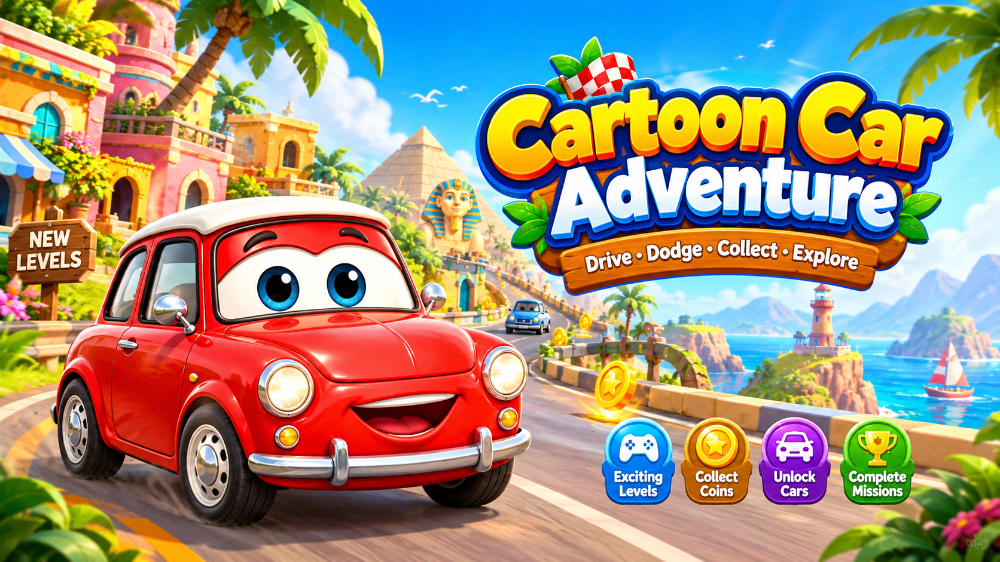

# 🚗 Cartoon Car Adventure

A colorful, family-friendly, mobile-first **cartoon driving game that runs entirely in the browser** — built with **React + TypeScript + Vite** for the menus/UI and **Phaser 3 (Arcade Physics)** for real gameplay. No backend, no installation, no real-money purchases.



## Play it

| Action | Keyboard (desktop) | Touch (mobile) |
| --- | --- | --- |
| Steer left / right | `◀` `▶` or `A` / `D` | Hold the big `◀` `▶` buttons |
| Speed up | `▲` or `W` | Hold **GAS** |
| Brake | `▼` or `S` | Hold **BRAKE** |
| Pause | `P` or `Esc` | ⏸ button (top-left) |

**Goal:** drive the full distance to finish a level. Collect coins, dodge traffic,
cones and barriers. 3 crashes ends the run (cones only slow you down).
Earn up to **3 stars** per level: finish + coin goal + clean (crash-free) driving.
Near misses give bonus points!

## Features

- **Reference-style home screen** — original AI-generated tropical town + cute 3D-style hero car with idle animation, top HUD (profile / coins / hearts with a *real* regeneration timer), treasure-milestone progress bar, reward Boost selector, big green `LEVEL n` button and a 5-tab bottom navigation. Every button works.
- **Real gameplay (Phaser 3)** — scrolling themed roads, smooth steering/acceleration/braking, traffic cars & trucks, cones/barriers, spinning coin chains, near-miss bonuses, crash invulnerability/blink, camera shake, particles, countdown, pause, auto-pause when the tab is hidden.
- **5 levels** — Sunny Streets, Palm Paradise, Desert Road, City Rush, Golden Highway: different distances, coin goals, traffic density/speed and roadside themes (palms, cacti, city buildings…), plus an **Endless mode** with ramping difficulty and a saved best score.
- **Progression & economy** — coins, hearts (start a run = 1 heart, finishing refunds it, +1 every 90 s, or buy for 50 coins), level unlocks & stars, Boost ×1/×2/×3 (bigger rewards, busier roads), 7-day daily rewards, a repeatable 250-coin treasure milestone.
- **Garage** — 4 original cartoon cars (Ruby, Officer Sky, Sunny Taxi, Minty) with distinct looks and Speed/Acceleration/Handling stats that genuinely change handling & top speed.
- **Shop** — cars + 3 functional upgrades (Coin Magnet, Safety Shield, Turbo Tires) with confirmation dialogs, balance checks and owned/selected states. Earned currency only.
- **Trophies & missions** — 9 missions tracked from real gameplay events, claimable coin rewards, level-star overview and lifetime stats.
- **Settings** — music/SFX volume sliders (applied instantly), mute, vibration toggle, how-to-play, confirmed progress reset.
- **Original synthesized audio** — cheerful music loop, engine hum that follows your speed, coin/crash/shield/win/lose/click sounds via Web Audio (no audio files, no licensing issues). Starts after the first user tap, per browser autoplay rules.
- **Persistent saves** — everything lives in `localStorage` with validation and safe fallbacks, so refreshes never lose progress.
- **Responsive layouts for every device** — 9:16-first mobile portrait (pixel-identical to the original design), compact heights on mobile landscape (All Levels + Endless as a balanced row), a compact left info rail on tablet portrait, and a three-column landscape layout on laptop/desktop/ultrawide where the game card expands with the window while UI elements stay proportionally sized — never a stretched canvas or an enlarged mobile interface.
- **Smart PWA install popup** — appears automatically ~10 seconds after load, only in browsers where installation is supported and the app isn't already installed; it never interrupts gameplay or another modal and won't reappear in the same session after dismissal. There is no permanent install button.

## Run locally

Requirements: Node.js 18+ (developed on Node 20).

```bash
npm install --legacy-peer-deps   # --legacy-peer-deps avoids an npm 10 peer-resolution bug with the very latest Vite/React
npm run dev                      # http://localhost:5173
```

## Production build & deployment

```bash
npm run build      # type-checks (tsc) then builds to dist/
npm run preview    # serve the production build locally
```

Deployment is static — any static host works:

- **Vercel:** import the repo (a `vercel.json` is included) or run `npx vercel --prod`. Framework preset: *Vite*, output directory: `dist`.
- **Netlify / GitHub Pages / nginx / S3:** publish the `dist/` folder. The game uses no client-side routing, so no rewrite rules are required.

No environment variables, API keys or backend services are needed.

## Project structure

```
cartoon-car-adventure/
├── public/
│   └── assets/
│       ├── cars/            # AI-generated hero car artwork (transparent PNGs)
│       └── environments/    # AI-generated home-screen town background
├── src/
│   ├── App.tsx              # App state machine, economy actions, modals, toasts
│   ├── main.tsx
│   ├── styles.css           # All UI styling (glossy mobile-game design system)
│   ├── lib/
│   │   ├── gameData.ts      # Cars, levels, missions, economy config, validated save system
│   │   └── audio.ts         # Web-Audio music/SFX/engine synthesizer
│   ├── game/
│   │   └── RacingScene.ts  # Phaser 3 scene: driving, spawning, collisions, particles
│   ├── components/
│   │   ├── ui.tsx           # TopHUD, BottomNav, Modal, Stars, stat bars
│   │   ├── GameViewport.tsx # Phaser host, gameplay HUD, touch controls, pause/results
│   │   └── pwa.tsx          # Automatic install popup, offline & update banners
│   └── screens/
│       ├── HomeScreen.tsx
│       ├── GarageScreen.tsx
│       ├── ShopScreen.tsx
│       ├── TrophiesScreen.tsx
│       └── SettingsScreen.tsx
├── scripts/
│   ├── smoke.mjs            # Headless browser test: home, driving, pause, tabs
│   └── progression.mjs      # Headless test: daily reward, purchases, victory, unlocks, persistence
├── index.html
├── vite.config.ts
└── vercel.json
```

React owns menus/HUD; Phaser owns the race. They communicate through a small
bridge (`onHud` throttled to ~8 updates/sec, `onEvent` for sounds, `onFinish`
once per run), so gameplay never triggers per-frame React renders.
Phaser is lazy-loaded, keeping the initial bundle at ~86 KB gzipped.

## Assets

All artwork is **original and generated for this project**:

- `home-bg.jpg` — tropical cartoon town plaza (AI-generated, no text/UI).
- `car-*-hero.png` — four cute 3/4-view cartoon cars (AI-generated on white, background cut out programmatically and optimized).
- Top-down gameplay sprites (cars, truck, coins, cones, barriers, palms, buildings…) are **drawn at runtime** with Phaser Graphics in `RacingScene.ts`, so every car colour/variant stays perfectly consistent and the download stays small.
- Icons: [Lucide](https://lucide.dev). Font: Fredoka (Google Fonts) with system fallbacks.
- Audio: fully synthesized at runtime (`src/lib/audio.ts`) — zero audio files.

To replace artwork, drop new files into `public/assets/…` with the same names
(or update paths in `src/lib/gameData.ts` / `HomeScreen.tsx`).

## Testing

Automated headless-browser tests (Playwright) cover the home screen, real
driving input, collisions, pause, purchases, daily rewards, a 3-star victory,
level unlocking, the game-over flow and save persistence across reloads:

```bash
npx playwright-core install chromium   # one-time browser download (~120 MB)
npm run dev                            # in a second terminal
npm run test:smoke
npm run test:progression
```

Latest results: both suites pass with **zero console errors**
(screenshots in `docs/screenshots/`).

## Known limitations / honest notes

- Saves are per-browser/per-device `localStorage` (no accounts or cloud sync) — clearing browser data resets progress, by design for v1.
- Music/SFX are synthesized chiptune-style loops rather than recorded audio; volume and mute are fully functional.
- Top-down gameplay sprites are vector-drawn (not 3D renders like the hero cars) to keep 60 FPS on modest phones; they are intentionally styled to match.
- The game is portrait-first; landscape phones still work but portrait is the designed experience.

## License

Original project code and generated artwork — free to use and modify for your own projects.
